  

  <a href="https://www.linkedin.com/in/prajin-shan/">LinkedIn</a> &nbsp;·&nbsp;
  <a href="https://leetcode.com/u/prajin_s7/">LeetCode</a> &nbsp;·&nbsp;
  <a href="mailto:prajin.shanmugaraj@gmail.com">Email</a>

---

### Selected Work

| | Project | Focus | Status |
| :--- | :--- | :--- | :--- |
| `01` | **[Fit Surfer](https://github.com/PrajinShan)** | Fitness &amp; activity intelligence | `Production` |
| `02` | **[CCTV Adaptive Analytics](https://github.com/PrajinShan)** | Real-time 5G scene-density video optimization | `5G Hackathon` |
| `03` | **[Screenly AI](https://github.com/PrajinShan)** | AI resume screening &amp; CV assessment proctoring | `AI Platform` |
| `04` | **[Pathwise Companion](https://github.com/PrajinShan)** | Adaptive progression &amp; guidance assistant | `In Development` |

---

### Stack

`Python` · `Java` · `SQL` · `Pandas` · `NumPy` · `Scikit-Learn` · `Computer Vision` · `Tableau` · `Power BI` · `Git`

---

<table>
<tr>
<td width="52%" align="center">
  
</td>
<td width="48%" align="center">
  
</td>
</tr>
</table>

